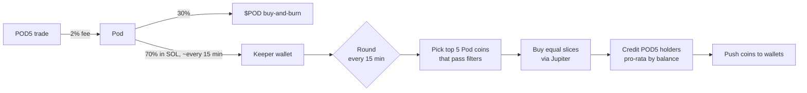

# POD5

**Hold one coin. Get the top five.**

[](https://github.com/pods-bit/pods/actions/workflows/ci.yml)

POD5 is a coin on the [orcapod.fun](https://orcapod.fun) launchpad (Solana, Orca Whirlpools). Every trade of POD5 pays Pod's 2% fee, and 70% of it arrives in our keeper wallet as SOL. Every 15 minutes the keeper spends that SOL on the biggest healthy coins on Pod, in equal slices, and sends them to POD5 holders in proportion to their holdings. There is nothing to claim, stake or vote on.

It's modelled on [ember5](https://www.ember5.xyz/), which does the same on embercurve.fun.

> **Status:** built and dry-run tested against live mainnet data. Not launched yet: POD5 still has to be created on Pod and the keeper funded. See [Going live](#going-live).

---

## How a round works



1. **Budget:** pot = keeper SOL − operating reserve − estimated network fees. A pot under the minimum rolls over.
2. **Basket:** Pod coins are ranked by market cap. The first five that pass every filter are kept: at least $5K liquidity, 50 holders, $1K 24h volume and 20 trades in 24h; at least 24h old; not flagged by Pod; no freeze or mint authority; and a Jupiter route with ≤ 3% price impact. Coins are identified by mint, never by ticker.
3. **Snapshot:** POD5 holders worth at least $30 qualify, weighted by balance. Pool vaults and other program accounts, the keeper, and excluded wallets are left out.
4. **Buy:** one swap per coin, each capped at 1% of that coin's pool liquidity. Holders are credited what actually arrived, not what was quoted.
5. **Deliver:** a share is sent at once if the wallet already holds that coin. Otherwise it waits until it's worth more than the ~0.0015 SOL token-account rent; then the account is opened and the rent is taken from the share. Leftover dust and withheld rent go back into the next round.

Today Pod is young and thin, so usually only one coin passes. That's why the site says "up to five".

## Project structure

```
.
├── keeper/                 Round service (Node + TypeScript)
│   ├── src/
│   │   ├── index.ts        CLI: round | daemon | publish
│   │   ├── config.ts       Every tunable, overridable by env var
│   │   ├── sources/        Pod API client, Jupiter quotes/swaps/prices
│   │   ├── chain/          RPC + tx sending, mint safety checks, holder snapshots
│   │   ├── round/          plan (pure math), selectBasket, buy, deliver, runner
│   │   ├── ledger/         SQLite ledger (node:sqlite): rounds, buys, owed, carry
│   │   └── publish.ts      Writes state.json / owed.json for the site
│   ├── test/               Vitest unit tests (chain fully mocked)
│   └── scripts/smoke-io.ts Read-only live checks against mainnet
├── web/                    Static dashboard + docs (Vite, vanilla TypeScript)
│   ├── index.html          Live basket, fees waiting, rounds, wallet checker
│   ├── docs.html           How it works + FAQ
│   └── public/sample/      Preview data shown before the keeper publishes
├── shared/types.ts         JSON contract between keeper and site
├── docs/
│   ├── plan.html           Project plan
│   └── DESIGN.md           Design system (Cohere-inspired)
└── .github/workflows/      CI: typecheck, tests, build
```

## Quick start

Requires **Node 22.13+** (Node 24 recommended; the ledger uses the built-in `node:sqlite`).

```bash
npm run install:all   # installs keeper/ and web/
npm run check         # typecheck + tests + site build
npm run dev           # site at http://localhost:5173 (sample data)
```

### Dry run against live data

Reads Pod, Jupiter and Solana; writes and sends nothing. Until POD5 exists, borrow another Pod coin's holder list:

```bash
cd keeper
cp .env.example .env    # set KEEPER_PUBKEY (any address works for a dry run)
npx tsx src/index.ts round --dry-run --pot 1 --holders-of <pod coin mint>
```

It prints the pot, the selected and rejected coins with reasons, each slice's quote and price impact, eligible wallets and their simulated shares. It also writes `state.json` for the site, so `npm run dev` then shows the real basket.

## Configuration

All settings live in [`keeper/src/config.ts`](keeper/src/config.ts) and can be overridden in `keeper/.env` ([example](keeper/.env.example)).

| Variable | Default | Meaning |
|---|---|---|
| `RPC_URL` | public mainnet | Use a paid RPC in production (holder snapshots use `getProgramAccounts`) |
| `KEEPER_KEYPAIR` | – | Path to the keeper's keypair JSON. Required for live rounds |
| `POD5_MINT` | – | POD5's mint, once launched |
| `EXCLUDE_WALLETS` | Pod wallets | Never paid: POD5 pool, deployer, Pod platform and treasury |
| `ROUND_INTERVAL_MIN` | `15` | Minutes between rounds |
| `MIN_POT_SOL` / `OP_RESERVE_SOL` | `0.05` / `0.05` | Skip threshold, and SOL always kept for fees |
| `POT_CAP_SOL` | none | Max spend per round; use about `0.2` for the first rounds |
| `MIN_HOLD_USD` | `30` | POD5 value needed to qualify |
| `MAX_COINS` | `5` | Basket size |
| `MIN_LIQ_USD` / `MAX_SLICE_OF_LIQ` | `5000` / `0.01` | Liquidity floor and per-buy cap |
| `MAX_IMPACT_BPS` | `300` | Max measured price impact per buy |
| `MIN_HOLDERS` / `MIN_VOL24H_USD` / `MIN_TRADES24H` / `MIN_AGE_H` | `50` / `1000` / `20` / `24` | Basket activity filters |
| `RENT_MARGIN` | `1.5` | A share must be worth this × the account rent before an account is opened |
| `ALERT_WEBHOOK_URL` | – | Discord or Slack webhook for alerts |

Site settings (`web/.env`): `VITE_DATA_BASE` (where `state.json` / `owed.json` are served) and `VITE_RPC_URL` (an RPC that accepts browser requests; otherwise the site uses the balance and prices the keeper publishes).

## Scripts

| Command | What it does |
|---|---|
| `npm run check` | Typecheck both packages, run the tests, build the site |
| `npm test` | Keeper unit tests |
| `npm run dev` | Site dev server |
| `npm run build` | Static site into `web/dist` |
| `npm --prefix keeper run round` | One live round (needs a keypair) |
| `npm --prefix keeper run daemon` | A round every `ROUND_INTERVAL_MIN` minutes |
| `cd keeper && npx tsx scripts/smoke-io.ts` | Read-only live checks of Pod, Jupiter and RPC |

## Safety

- **No double spends after a crash.** Every buy and delivery transaction is recorded before it's sent and settled from the chain afterwards. A crash never causes a second buy or a second payment.
- **Balances only change on confirmation.** Owed balances drop only once a delivery is confirmed. The ledger refuses to let them go negative.
- **Never overspends.** The keeper never transfers more than it holds, and always keeps an operating reserve of SOL.
- **Off switches.** Create `keeper/data/STOP` to pause rounds. `POT_CAP_SOL` limits spending per round.
- **Locks and alerts.** A process lock stops two rounds overlapping. Errors and "no fee inflow for 6 hours" are sent to `ALERT_WEBHOOK_URL`.
- **No secrets in the repo.** Keys and `.env` files are git-ignored. Keep the keeper a hot wallet holding only its working float.

## Going live

1. Launch POD5 on [orcapod.fun/create](https://orcapod.fun/create): pair **SOL**, module **Harbor & Crew**, payout wallet = the keeper.
2. Set `POD5_MINT`. Add POD5's pool, the deployer and Pod's wallets to `EXCLUDE_WALLETS`.
3. Point `RPC_URL` at a paid RPC and `PUBLISH_DIR` at the folder the site serves as `data/`.
4. Run dry-runs, then canary rounds with `POT_CAP_SOL=0.2`, then lift the cap.

Known gaps:
- A full round hasn't yet been run on a local fork of mainnet.
- A wallet whose transfers always fail currently blocks delivery of that coin. It needs a skip list.
- Jupiter's `/swap/v1` API is no longer actively maintained; the base URL is configurable.

## Disclaimer

POD5 is experimental software that handles real funds on a young, thin market. Nothing here is financial advice. Tokens can lose all their value, and the coins in the basket are third-party memes.
